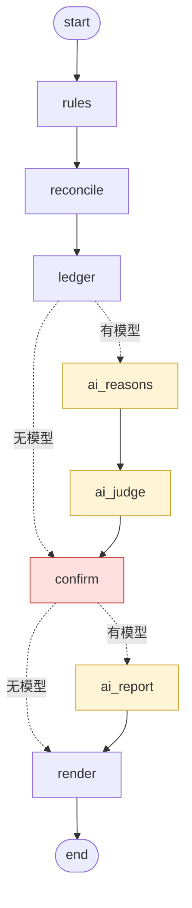

# 考勤核算 LangGraph 演示

一个用 LangGraph 1.x 编排的考勤核算流程演示(规则节点 + 可选的大模型节点),练习三件事:断点续跑、可以隔天做的人工确认、没有模型 key 时自动降级为纯规则。

**规则口径是示例。** 上下班时间、加班怎么算、哪些请假计入、计薪日公式等参数全部是为演示设定的通用值,集中在 [`demo/policy.py`](demo/policy.py),可以按自己的制度修改。数据全部是固定种子生成的合成数据。

*English: A LangGraph 1.x demo of an attendance/payroll-hours pipeline (rule nodes + optional LLM nodes), demonstrating checkpoint-based crash recovery, `interrupt()` human review that survives process restarts, and a no-API-key fallback path. All policy parameters are illustrative defaults (see `demo/policy.py`). All data is synthetic and generated from a fixed seed.*

- **断点续跑**:挂 `SqliteSaver`,进程被 `kill -9` 后,用同一个 `thread_id` 从最后一个 checkpoint 接着跑,已完成的节点不重跑。
- **人工确认可以隔天做**:确认节点用 `interrupt()` 停图,状态落盘;第二天换一个进程用 `Command(resume=...)` 回答,图接着走。
- **没 key 自动降级**:条件边按 state 里的 `use_ai` 分流;没有 `LLM_API_KEY` 或加了 `--no-ai` 时,三个 AI 节点整段跳过,月表数字不变。

## 图结构



| 节点 | 类型 | 做什么 |
|---|---|---|
| `rules` | 规则 | 打卡 → 每人每日一行、原始异常(迟到/早退/未打卡/整天无卡)、加班(工作日/休息日/节假日) |
| `reconcile` | 规则 | 用申请单抵消异常:整天假抵全天,上午半天假抵迟到,批准的补卡抵缺卡;抵不掉的未打卡和整天无卡送人工 |
| `ledger` | 规则 | 请假清单(已批准/待批/已拒绝,折合天) |
| `ai_reasons` | 大模型 | 请假理由分类 + 理由与假期类型不符的标记(脱敏后发送) |
| `ai_judge` | 大模型 | 给待确认异常一个初步判断和置信度,挂到待确认清单上 |
| `confirm` | 人工 | `interrupt()` 停图,等人逐条决定"确认异常 / 核销";没回答的保持"待人工复核" |
| `ai_report` | 大模型 | 月度小结正文,提示词要求只引用输入里的数字 |
| `render` | 规则 | 月表 CSV(20 列)+ 月度小结 Markdown |

虚线是条件边(`after_ledger` / `after_confirm`)。两条分支都经过 `confirm`:没有模型时,规则层找出的可能旷工同样必须由人决定,系统不自动认定旷工。

代码结构:

```
demo/
  policy.py    规则参数(示例口径,可按实际制度修改)
  synth.py     合成数据生成器(固定种子)
  rules.py     规则层:rules / reconcile / ledger / 月表,纯确定性计算
  ai_nodes.py  三个 AI 函数 + 脱敏 + 模型输出检查,模型通过参数注入
  graph.py     LangGraph 编排:8 个节点、2 条条件边、checkpointer、interrupt
  run.py       命令行入口
tests/         5 个测试
eval/          故障注入(变异)检查脚本
```

## 示例口径

下面是 `demo/policy.py` 里的默认值,都是演示用的示例:

| 项目 | 示例值 |
|---|---|
| 班次 | 09:00–18:00,上班卡晚于 09:05 才记迟到(5 分钟宽限) |
| 工作日加班 | 下班后 30 分钟(18:30)起算,只看下班卡 |
| 加班门槛与取整 | 单日不足 30 分钟不记;按 15 分钟向下取整后折小时 |
| 加班分类 | 工作日、休息日、节假日分三列 |
| 请假计入 | 只有"已批准"的计入;"待批"只在备注里提示,当天没打卡的照样送人工确认 |
| 计薪日 | 应出勤日 − 事假日 − 病假日 × 0.5 − 旷工日;年假、婚假、丧假、调休不扣 |
| 按日计薪人员 | 计薪日 = 实际出勤日,请假不再另扣 |
| 旷工 | 系统不自动认定,只有人工选"确认异常"才计 |

## 运行

需要 Python 3.10+(开发时用 3.13)。纯规则模式不需要任何 API key,也不联网。

```bash
make setup      # python3 -m venv .venv && .venv/bin/pip install -r requirements.txt
make test       # .venv/bin/python -m pytest -q
make demo       # 造数据 → 停在人工确认 → 查看等待项 → 回答 → 出月表和月度小结
```

`requirements.txt` 锁定了开发时实际使用的全部版本。`make demo` 等价于下面几步,也可以手动逐条跑:

```bash
.venv/bin/python -m demo.run --thread june --no-ai                  # 造数据并跑,停在人工确认
.venv/bin/python -m demo.run --thread june --status                 # 看停在哪个节点、在等什么
.venv/bin/python -m demo.run --thread june --decide '{"51":"确认异常","54":"核销"}'
.venv/bin/python -m demo.run --thread june --resume                 # 进程被杀后续跑
```

- `--auto` 不停在确认节点,未决项写进月表备注(`make demo-auto`)。
- 产物在 `work/output/`:`月表-2026-06.csv`、`月报-2026-06.md`。
- `51`、`54` 是合成数据里两条"整天无卡、也没有请假"的待确认项编号(种子固定,编号固定),可以用 `--status` 核对。

### AI 分支会把什么发到哪里

- **什么时候会调用模型**:只有环境里有 `LLM_API_KEY`,并且命令没有加 `--no-ai` 时。`Makefile` 里的 `demo`、`demo-auto` 都带了 `--no-ai`;测试会删掉 `LLM_API_KEY`,也不联网。
- **默认发往哪里**:有 key 时默认调用 DeepSeek 的 OpenAI 兼容接口,地址 `https://api.deepseek.com`,模型 `deepseek-chat`。可以用 `LLM_BASE_URL`、`LLM_MODEL` 换成别的 OpenAI 兼容服务(包括本机部署的模型)。需要另外 `pip install openai`。
- **发出去的内容**:(1) 请假记录的类型、天数和理由(理由截断到 100 字,里面出现的员工全名换成"某员工");(2) 待确认异常的日期、类型、当月补卡次数和异常条数;(3) 各节点的汇总统计数字。员工 userid 换成只存在内存里的临时编号(P01、P02……),工号和姓名不发送。请假理由里的病情、家事等内容**不会**被去掉,会原样发给模型服务。
- **怎么关掉**:加 `--no-ai`,或者不设置 `LLM_API_KEY`(`unset LLM_API_KEY`)。关掉后三个 AI 节点整段跳过,月表数字完全不变。
- key 只在调用时交给 SDK 的 client 对象,不打印、不进 state、不进 checkpoint。

## 评测

### 5 个测试

| 测试 | 验证什么 |
|---|---|
| `test_resume_after_kill` | 子进程跑到 `ledger` 时 SIGKILL;checkpoint 停在 `ledger` 前;新进程 `--resume` 跑完;已完成节点不重跑(只有被杀时正在跑的 `ledger` 执行了 2 次);产物和一口气跑完的基线逐字节相同 |
| `test_interrupt_confirm` | 图停在 `confirm`、未出月表;换一个 checkpointer 连接和图对象(模拟另一个进程)回答后跑完;确认的计旷工并扣计薪日,核销的不计,没答的进备注,写错的编号被点名 |
| `test_no_key_fallback` | 删掉 `LLM_API_KEY` → `use_ai=False`,AI 节点零执行、库里没有 AI 表;30 人的工作日加班和迟到次数与测试内独立重算(不调用 `demo.rules`,口径数值在测试里写死)逐人一致;另有 30 个埋点期望值和 4 条备注逐项核对 |
| `test_ai_branch_fake_llm`(正常输出) | 注入假模型走 AI 分支;初判挂上待确认项;发给模型的 3 次请求里不出现任何员工 userid、工号和姓名;同样的人工决定下,月表和纯规则分支逐字节相同 |
| `test_ai_branch_fake_llm`(类型错误) | 假模型返回 JSON 但字段类型不对(`items` 不是列表、`id` 不是数字、`confidence` 是字符串、`reason` 是列表、`sections` 是字符串):不抛异常,坏的条目被丢弃并记 warning 日志,只有格式正确的一条初判挂上,月度小结改用规则模板,月表和纯规则分支逐字节相同 |

测试不联网、不需要 key。`test_resume_after_kill` 用到 SIGKILL,只在 macOS / Linux 上跑过。

### 故障注入:10 处,全部检出

每处故障只改一行,在临时拷贝里改、跑全部测试、再丢掉拷贝。复现:`make mutation`(即 `.venv/bin/python eval/mutation_check.py`)。

| # | 注入的故障 | 怎么注入 | 抓到它的测试 |
|---|---|---|---|
| M1 | 加班门槛错误 | `policy.py`:`OT_MIN_MINUTES = 30` 改成 `15` | `test_no_key_fallback` |
| M2 | 待批的请假也被计入 | `policy.py`:`LEAVE_COUNTED_STATUSES` 加上 `"待批"` | `test_no_key_fallback`、`test_interrupt_confirm` |
| M3 | 加班不再按 15 分钟取整 | `policy.py`:`OT_STEP_MIN = 15` 改成 `1` | `test_no_key_fallback` |
| M4 | 人工确认节点不停图 | `graph.py`:去掉 `interrupt(...)` 调用,直接用问题 payload 当答复 | `test_interrupt_confirm`、`test_ai_branch_fake_llm` |
| M5 | 条件边写反 | `graph.py`:`after_ledger` 的两个返回值对调 | `test_no_key_fallback`、`test_ai_branch_fake_llm`、`test_resume_after_kill` |
| M6 | 续跑读不到 checkpoint | `run.py`:checkpointer 从 `checkpoints.db` 换成 `":memory:"` | `test_resume_after_kill` |
| M7 | 空答复让图永远卡住 | `graph.py`:`Command(resume={"decisions": d})` 改成裸传 `Command(resume=d)` | `test_interrupt_confirm`、`test_ai_branch_fake_llm` |
| M8 | 脱敏失效 | `ai_nodes.py`:`Pseudonyms.anon` 直接返回原 userid | `test_ai_branch_fake_llm` |
| M9 | 写错的答复编号被静默吞掉 | `graph.py`:`无效答复` 恒为空列表 | `test_interrupt_confirm` |
| M10 | AI 初判越权写进月表 | `graph.py`:`render` 把 AI 判为"可能旷工"的项当成"确认异常" | `test_ai_branch_fake_llm` |

最近一次运行输出:`10/10 个变异被测试抓到`。

## 设计取舍

### 为什么规则节点和模型节点分开

月表里的每个数字都来自 `rules.py`,模型只放在三个不产生月表数字的节点上:

| 节点 | 模型产出 | 产出去哪 |
|---|---|---|
| `ai_reasons` | 理由分类、类型不符标记 | 单独的 `ai_reason_class` 表和月度小结统计,不进月表 |
| `ai_judge` | 待确认异常的初步判断和置信度 | 挂在待确认清单上供人参考,最终由 `confirm` 节点的人工决定生效 |
| `ai_report` | 月度小结正文 | 月报 Markdown;没有模型时用字符串模板填同样的数字 |

这样分的理由对任何考勤场景都成立:

- **会影响计薪的数字必须可复现、可追溯。** 同样的输入,规则代码每次给出同样的结果,错了能定位到哪一行、哪条规则,改完重跑结果确定;模型输出不可复现,错了也说不出为什么。所以模型只做"建议"和"措辞",不做"计数"。
- **敏感字段尽量少出进程。** 考勤数据里有姓名、工号、请假理由(常带病情和家事)。模型节点只拿到脱敏后的最小字段,规则节点处理完整数据且不需要联网。
- **两类节点的失败方式不同。** 规则节点出错应当直接失败、让人修;模型节点出错(超时、限流、格式不对)应当降级、让流程继续。分成不同节点后,两种策略各管各的。

模型调用函数通过 LangGraph 的 runtime context(`context_schema`)注入,不进 state,所以 checkpoint 里没有 client 对象和 key,测试可以直接塞假模型。

模型的返回值一律当不可信输入逐项检查:调用出错、返回的不是 JSON 对象、字段类型不对(`id` 不是已知编号、`confidence` 不是 0–1 的数等),都记一条 warning 日志并丢掉这一条或整批,图照规则结果往下走,不会因为模型输出格式不对而中断。

### 人工确认为什么用 interrupt

如果确认节点用 `input()` 阻塞等待:进程一关,前面跑的结果和待确认状态全丢,也不能第二天再答。`interrupt()` 把图停在 `confirm`,整个 state 写进 checkpoint;可以隔天、在另一个进程里用 `--decide` 回答,图从 `confirm` 接着往下走。旷工这类判断本来就需要人去核实情况,等待时间以天计,流程必须能停下来、落盘、之后再接上。

实现时注意到两点:

- **`Command(resume={})` 不算答复。** 空字典会让图再次 interrupt。"这批全部先不决定"时传的正是空字典,图会一直卡在确认节点。所以答复统一包成 `{"decisions": {...}}`(见故障 M7)。
- **interrupt 恢复时,节点从头再执行一遍。** 测试里 `confirm` 被记录执行了 2 次。所以 `interrupt()` 之前只能做读操作,写库放在拿到答复之后;规则函数都先删表再重建,重复执行结果不变。

### 为什么没有 key 也要能跑完

- **模型是可选增强,不是前提。** 没有 key、没有外网、额度用完、模型服务暂时不可用,都不应该让月度核算停摆。条件边按 state 里的 `use_ai` 分流,没有模型时三个 AI 节点整段跳过,月度小结改用字符串模板。
- **降级不改变结果。** `test_ai_branch_fake_llm` 逐字节比对:同样的人工决定下,走 AI 分支和走纯规则分支的月表完全相同。这条测试同时约束了"AI 不许写进月表"。
- **分支在开跑时决定,写进 state。** 一张图加两条条件边,而不是按有没有 key 拼两张不同的图;续跑时即使环境变量变了,也沿用开跑时的分支,不会中途换路。
- **其他实现细节:** 节点只返回局部更新,不原地修改 state;每个节点跑完同步落 checkpoint(`durability="sync"`),落盘后才进入下一个节点。

## 失败案例与局限

- **真实模型没有在本仓库里评测过。** AI 分支只用假模型测试,测试证明的是"分支切换正确、脱敏生效、AI 不改月表、坏输出能降级",不证明分类和初判的准确率。
- **月度小结"只引用输入数字"只是提示词约束。** 代码没有校验 AI 正文里的数字是否都出现在输入统计里。
- **脱敏是字符串级别的。** 姓名替换只覆盖员工表里的全名,简称、昵称抓不到;请假理由截断到 100 字后原样发出,里面的病情、家事等敏感信息并没有去掉。对这类数据,纯规则分支(`--no-ai`)是更稳妥的默认。
- **规则是简化的示例。** 单一班次、每天一上一下两次打卡、单月核算;没有跨夜班、弹性工时、多次打卡取首末、跨月请假拆分。
- **一个工作目录只适合一个线程。** 每次从头 `start` 都会重新生成 `data.db`,会影响同一目录下其他挂起中的线程;demo 没有做线程间的数据隔离。业务库(`data.db`)和 checkpoint 库是两个 SQLite 文件,节点写业务库和落 checkpoint 不在同一个事务里,靠"先删后写"的幂等来兜底。
- **`node_runs` 日志在 interrupt 之前写入。** 这是"interrupt 前只读"规则的一个有意例外(测试靠它数节点执行次数),所以 `confirm` 的执行记录会是 2 条。
- **故障注入是手工挑的 10 处**,不是用 mutmut 之类的工具系统生成的;10/10 检出只说明这 10 类错误会被抓到,不代表测试覆盖了全部规则。

## 数据说明

- 全部数据由 `demo/synth.py` 用固定种子(`SEED = 20260928`)生成,不读取任何真实考勤库、员工信息或系统凭据。重复生成结果逐字节一致。
- 30 名虚拟员工,姓名为"虚拟员工01"–"虚拟员工30",工号 E901–E930;覆盖 2026-06 整月(21 个工作日,6 月 19 日端午为节假日)。
- 刻意放进去的情况:工作日晚走(含不足 30 分钟不记的)、周六和端午连休周末到岗(休息日加班)、端午当天到岗(节假日加班)、周日到岗不足 30 分钟、迟到早退和未打卡、宽限内到岗不算迟到、上午半天假抵迟到、补卡批准与被拒、待批和被拒的请假、两条整天无卡、也没有请假的(可能旷工,送人工确认)、按日计薪人员按实际出勤日计薪。每一条在 `synth.py` 里都有注释,对应的期望值写在 `tests/test_no_key_fallback.py`。
- 部门、岗位、请假理由均为虚构文本。

## License

MIT,见 [LICENSE](LICENSE)。
